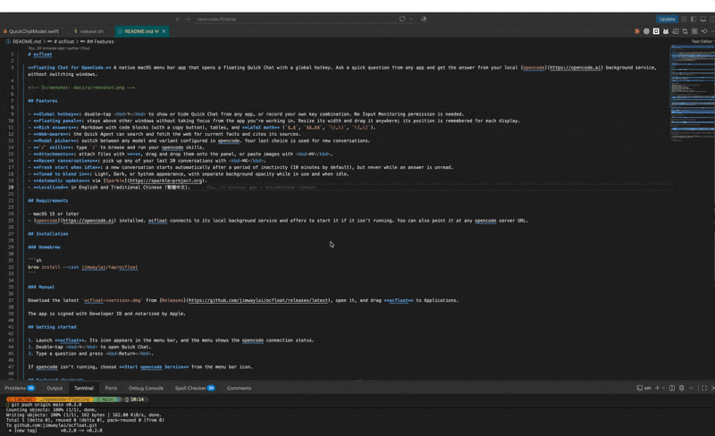

# ocfloat

**Floating Chat for OpenCode.** A native macOS menu bar app that opens a floating Quick Chat with a global hotkey. Ask a quick question from any app and get the answer from your local [opencode](https://opencode.ai) background service, without switching windows.

<p align="center">
  
</p>

## Features

- **Global hotkey**: double-tap <kbd>⌥</kbd> to show or hide Quick Chat from any app, or record your own key combination. No Input Monitoring permission is needed.
- **Floating panel**: stays above other windows without taking focus from the app you're working in. Resize its width and drag it anywhere; its position is remembered for each display.
- **Rich answers**: Markdown with code blocks (with a copy button), tables, and **LaTeX math** (`$…$`, `$$…$$`, `\(…\)`, `\[…\]`).
- **Web-aware**: the Quick Agent can search and fetch the web for current facts and cites its sources.
- **Model picker**: switch between any model and variant configured in opencode. Your last choice is used for new conversations.
- **`/` skills**: type `/` to browse and run your opencode skills.
- **Attachments**: attach files with **+**, drag and drop them onto the panel, or paste images with <kbd>⌘V</kbd>.
- **Recent conversations**: pick up any of your last 20 conversations with <kbd>⌘K</kbd>.
- **Fresh start when idle**: a new conversation starts automatically after a period of inactivity (10 minutes by default), but never while an answer is unread.
- **Tuned to blend in**: Light, Dark, or System appearance, with separate background opacity while in use and when idle.
- **Automatic updates** via [Sparkle](https://sparkle-project.org).
- **Localized** in English and Traditional Chinese (繁體中文).

## Requirements

- macOS 15 or later
- [opencode](https://opencode.ai) installed. ocfloat connects to its local background service and offers to start it if it isn't running. You can also point it at any opencode server URL.

## Installation

### Homebrew

```sh
brew install --cask jimwaylai/tap/ocfloat
```

### Manual

Download the latest `ocfloat-<version>.dmg` from [Releases](https://github.com/jimwaylai/ocfloat/releases/latest), open it, and drag **ocfloat** to Applications.

The app is signed with Developer ID and notarized by Apple.

## Getting started

1. Launch **ocfloat**. Its icon appears in the menu bar, and the menu shows the opencode connection status.
2. Double-tap <kbd>⌥</kbd> to open Quick Chat.
3. Type a question and press <kbd>Return</kbd>.

If opencode isn't running, choose **Start opencode Service** from the menu bar icon.

## Keyboard shortcuts

| Shortcut | Action |
| --- | --- |
| Double-tap <kbd>⌥</kbd> (configurable) | Show, focus, or hide Quick Chat |
| <kbd>Return</kbd> | Send |
| <kbd>⇧</kbd> <kbd>Return</kbd> | New line |
| <kbd>⌘</kbd> <kbd>.</kbd> | Stop the answer |
| <kbd>⌘</kbd> <kbd>N</kbd> | New conversation |
| <kbd>⌘</kbd> <kbd>K</kbd> | Recent conversations |
| <kbd>⌘</kbd> <kbd>V</kbd> | Paste text, files, or images |
| <kbd>/</kbd> | Skill menu |
| <kbd>Esc</kbd> or <kbd>⌘</kbd> <kbd>W</kbd> | Hide Quick Chat |
| <kbd>↑</kbd> <kbd>↓</kbd>, <kbd>Return</kbd>, <kbd>Esc</kbd> | Navigate and choose in menus |

## Settings

Open **Settings…** from the menu bar icon (<kbd>⌘</kbd> <kbd>,</kbd>).

- **General**: language, hotkey (double-tap <kbd>⌥</kbd> or a key combination), launch at login, and how long before an idle conversation is replaced by a new one.
- **Appearance**: Light, Dark, or System, and the panel's background opacity while in use and when idle. Text always stays fully opaque.
- **opencode**: use the local background service or a custom server (URL and password), set the path to the `opencode` executable, and open or restore the Quick Agent file.
- **About**: version and update settings.

> **Tip:** if you choose <kbd>⌥</kbd> <kbd>Space</kbd> as your shortcut and Spotlight already uses it, ocfloat temporarily falls back to another shortcut and links you to System Settings to free it up.

## How it works

- Every conversation is an opencode session run in a neutral **scratch workspace** (`~/Library/Application Support/tw.com.shitu.ocfloat/scratch`), so Quick Chat never touches your code projects.
- Answers come from a dedicated, hidden **Quick Agent**, `quick-chat`. It is tuned for short, direct answers, may only use web search and web fetch, and never asks for permissions. Your global permission rules can't widen its access.
- The agent lives in your opencode config at `~/.config/opencode/agents/quick-chat.md` (or under `$XDG_CONFIG_HOME`). Edit it to change its instructions or limits. ocfloat creates it only when it is missing and never overwrites your changes. Use **Restore Defaults…** in Settings to reset it.

## Building from source

Requires Xcode 27+ and [XcodeGen](https://github.com/yonaskolb/XcodeGen). The `.xcodeproj` is generated from `project.yml` and isn't checked in.

```sh
brew install xcodegen
git clone https://github.com/jimwaylai/ocfloat.git
cd ocfloat
xcodegen generate
open FloatingChat.xcodeproj
```

Build and test from the command line:

```sh
xcodebuild -project FloatingChat.xcodeproj -scheme FloatingChat -derivedDataPath build test
```

Debug builds are signed ad hoc and need no Apple Developer account:

```sh
xcodebuild -project FloatingChat.xcodeproj -scheme FloatingChat -configuration Debug -derivedDataPath build build
open build/Build/Products/Debug/ocfloat.app
```

Quit any installed copy first so the two don't compete for the global hotkey.

## Troubleshooting

- **The hotkey does nothing.** Check the menu bar menu. If it says the shortcut is used by another app, pick a different one in Settings → General.
- **"opencode is not installed".** Set the path to `opencode` in Settings → opencode, or install it in a standard location (`/opt/homebrew/bin`, `/usr/local/bin`, or `~/.opencode/bin`).
- **"opencode service is not running".** Choose **Start opencode Service** from the menu bar icon, or run `opencode service start`.
- **A formula shows as raw text.** It uses a LaTeX command the math renderer doesn't support. Please [open an issue](https://github.com/jimwaylai/ocfloat/issues) with the formula.

## Contributing

Issues and pull requests are welcome. Please run the tests before submitting, and see [CONTEXT.md](CONTEXT.md) for the project's domain vocabulary.

## Acknowledgements

- [opencode](https://opencode.ai): the AI coding agent behind every answer
- [Textual](https://github.com/gonzalezreal/textual) and [SwiftUI Math](https://github.com/gonzalezreal/swiftui-math): Markdown and math rendering
- [Sparkle](https://sparkle-project.org): software updates

## License

[MIT](LICENSE) © 2026 Jim Lai
